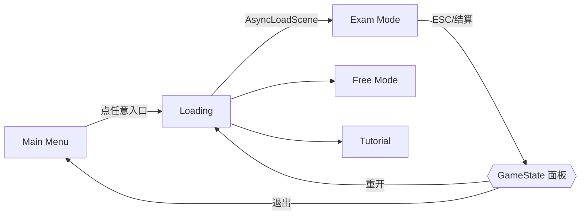
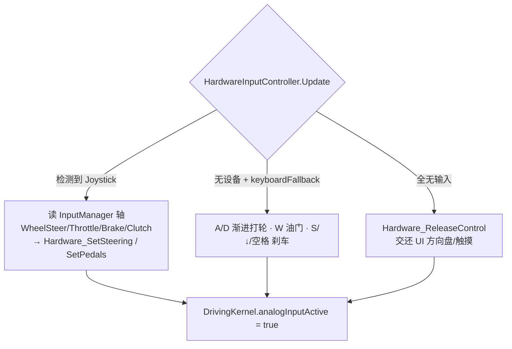

# 代码框架说明（Architecture）

> 面向需要改动本项目的人。看完这篇应该能回答：输入怎么变成车动、分数怎么被扣掉、
> 一个科目是怎么判通过的、回放是怎么录的。
> 配合 [AGENTS.md](AGENTS.md)（约定与坑）和 [INTEGRATION_NOTES.md](INTEGRATION_NOTES.md)（本 fork 相对上游改了什么）一起读。

---

## 1. 一句话概括

一个**单体式（monolithic）Unity 旧版架构**的驾考模拟器：脚本按"车辆 / 规则 / UI"三个目录分层，
层间大量使用 `FindObjectOfType` 与 `static` 状态直接互调，**没有 DI、没有事件总线、没有 ScriptableObject 配置层**。
理解成本的关键在于认清那几个全局耦合点（见 §3）。

```
输入源（UI 方向盘 / 外接方向盘 / 键盘 / 触摸）
        │
        ▼
  DrivingKernel ──► 4 × WheelCollider ──► Rigidbody 物理
        │
        ├──► 车速 speed ──► Car_Information（static）
        │                          │
        ▼                          ▼
  检测脚本 Det_*.cs / Wall.cs ──► DeductScore() ──► MyGameManager 结算（<80 不合格）
```

---

## 2. 模块清单

### 2.1 车辆核心 `Assets/Script/Car/kernelControl/`

| 文件 | 职责 |
|---|---|
| **`DrivingKernel.cs`** | ★ 驱动核心。四个 `WheelCollider` 的 steer / motor / brake 全部在此写入；阿克曼转向、模拟量踏板、制动力合成 |
| `HardwareInputController.cs` | 输入仲裁。外接方向盘（DirectInput 轴）→ 键盘 → 手放开交还 UI；档位/转向灯/手刹快捷键也在这 |
| `Car_HandleBrake.cs` | 手刹。`Activate` 标志 + `ChangeState()`（同步图标与音效） |
| `Car_Information.cs` | ★ 全局状态。分数 `static int Score`、`isStop`、`Speed` / `SpeedOrigin` |
| `CarAudioSourceManager.cs` | 引擎/起步/熄火音源与协程淡入淡出 |
| `VoicePromptAudio.cs` | 语音播报。`Play_HeGe()` / `Play_BuHeGe()` / `Play_ZhongTuTingChe()` / `Play_YaXian_100()` … |
| `FollowCar.cs` / `FocusCameraAnnal.cs` | 相机跟随与俯视标注 |
| `TPD.cs` / `FPD.cs` | 触摸/鼠标拖拽控制相机（第三人称 / 第一人称） |
| `CameraSwitch.cs` | 视角切换（V 键 / UI 按钮） |
| `UI_CarSpeed.cs` | 车速表 UI |
| `Retroreflector_MirrorFlip.cs` | 后视镜镜像翻转 |

### 2.2 车辆附加 `Assets/Script/Car/`

| 文件 | 职责 |
|---|---|
| `TurnLight.cs` | 转向灯 / 双闪。`SetLeft()` / `SetRight()` / `SetExigency()`，闪烁用 `Interval` 计时 + UI Image 同步 |

### 2.3 规则判定 `Assets/Script/DetectionRule/`

```
DetectionRule/
├── RuleScript/
│   ├── Det_DCRK.cs   倒车入库（3 步 · 210s · 压线 · 中途停车）
│   ├── Det_CFTC.cs   侧方停车（2 步 ·  90s）
│   ├── Det_BPQB.cs   半坡起步（1 步 ·  30s）
│   ├── Det_ZJZW.cs   直角转弯（2 步 ·  30s）
│   ├── Det_QXXS.cs   曲线行驶（仅中途停车，★ 无压线检测）
│   ├── End.cs        项目结束触发器：销毁当前项目的检测点
│   └── Victory.cs    终点触发器：通知 MyGameManager 游戏结束
├── Wall.cs           空气墙/实墙碰撞 → 扣 100 分
├── JinDu.cs          进度触发器：播报下一项目名 + 激活下一项目对象
└── EasyDriving/      （搬运，未接线）
    ├── SidelineDetector.cs     压线：轮子 / 车身出线事件
    ├── DistanceDetector.cs     两点距离
    ├── StopOffDetector.cs      中途停车计时
    ├── WheelStateDetector.cs   四轮进出库状态
    └── TagConst.cs             Tag 名常量
```

### 2.4 UI 与流程 `Assets/Script/MainGUI/`

| 文件 | 职责 |
|---|---|
| **`MyGameManager.cs`** | ★ 流程中枢。暂停/继续/重开/退出、合格判定（<80 不合格）、按所选项目摆放出生点 |
| `AsyncLoadScene.cs` + **`Globe`** | 异步加载与跨场景传参（`Globe.nextSceneName` / `Globe.loadM`） |
| `SelectPass.cs` | 单项选择，跨场景单例（`DontDestroyOnLoad`） |
| `GearsDangWei_Control.cs` | 档位 P/R/N/D，`P()`/`R()`/`N()`/`D()` 由 UI 与键盘共用 |
| `SteeringWheel2D.cs` | UI 方向盘（触摸/鼠标），`wheelAngle` / `maximumSteeringAngle` |
| `Button_Go.cs` / `Button_Stop.cs` / `Button_Rec.cs` | 油门 / 刹车 / 录制按钮（PointerDown/Up） |
| `Camera_ViewportMirror.cs` | 后视镜视口开关 |
| `Tutorial/` | 教程、关于、好友面板（公共聊天室测试功能） |
| `SelectSceneScript/` | 单项练习选择界面 |

### 2.5 录制回放 `Assets/Tool/Record result/`

| 文件 | 职责 |
|---|---|
| `ReplayManager.cs` | 单例。30Hz 采样，时间轴 Slider、播放/暂停/重播、回放时把车设为 `isKinematic` |
| `ReplayEntity.cs` | 挂在任何需要被记录的物体上，采样 Transform 状态 |

---

## 3. 三个全局耦合点（改动前必读）

### 3.1 `DrivingKernel` —— 唯一的驱动出口

所有对物理的写入最终都落到这里。**写入权必须单一**，这是本 fork 融合时踩过的最大的坑：

```
motorTorque  ← 油门路径
               · 布尔路径：MobileTerminal_AcceleratorPedal() → EnginePower() → 后轮
               · 模拟量路径：ApplyAnalogThrottle()            → 后轮
brakeTorque  ← 唯一出口：ApplyBrakeForces()
               · 取 max(UI 布尔刹车, 模拟量刹车) → 前轮
               · 后轮再叠加 手刹 Handle.Activate
steerAngle   ← ApplyAckermannSteering(steerInput) → 左右前轮各自角度
```

`Update()` 里的顺序：**选输入源 → 阿克曼 → （模拟量时）油门+刹车 → 转向视觉 → 轮子转动 → （非模拟量时）刹车**。

对外接口（**签名不可变**，场景按钮按名绑定）：

| 方法 | 说明 |
|---|---|
| `MobileTerminal_AcceleratorPedal(bool)` | UI 油门踏板按下/松开 |
| `MobileTerminal_BrakePedal(bool)` | UI 刹车踏板按下/松开 |
| `Resistance()` / `CancelResistance()` | 四轮刹车 / 解除 |
| `Hardware_SetSteering(float -1..1)` | 外接方向盘转向，同时置 `analogInputActive` 并反向同步 UI 方向盘 |
| `Hardware_SetPedals(throttle 0..1, brake 0..1)` | 外接踏板模拟量，支持半联动 |
| `Hardware_ReleaseControl()` | 交还控制权给 UI 方向盘 |

阿克曼公式（`useAckermannSteering` 可关）：
`R = wheelBase / tan(δ)`；内侧轮 `atan(L / (R − T/2))`，外侧轮 `atan(L / (R + T/2))`；L=轴距 2.6，T=轮距 1.5。

### 3.2 `Car_Information` —— 全局静态状态

```csharp
static int   Score = 100;                        // DeductScore(int) / GetScore()
static bool  isStop;                             // 速度 0 持续 IntervalSecond(2s) 后置 true
static float Speed, SpeedOrigin;                 // 每帧从 DrivingKernel 拷贝（带符号/绝对值）
```

它是**被所有 `Det_*.cs` 直接静态读取**的黑板。缺点很明显：多实例会串数据；优点是检测脚本写起来极短。

### 3.3 `MyGameManager` —— 流程中枢

- `GamePlayingFlag`：考试是否进行中。`Victory.cs` 把它置 `false` 表示跑完全程。
- `GamePauseFlag` + `Time.timeScale`：暂停实现（注意 `AsyncLoadScene` 强制 timeScale=1）。
- 判定：`Score < 80` → 不合格（红字 + `Play_BuHeGe()`）；`>= 80 && !GamePlayingFlag` → 合格（绿字 + `Play_HeGe()`）。
- 出生点：`SelectPass.sites.ToString()` → `GameObject.Find(名字)` → 摆放 `playerCarModel`。**场景里缺同名物体会 null。**

---

## 4. 场景流转



- 切场景统一走 `Loading` 中转，参数是 `Globe.nextSceneName` + `Globe.loadM`（Fast/Slow/Default 控制进度条速度）。
- 进度条是**假进度**（`InvokeRepeating` 累加 `curProgressValue` 到 100 才 `allowSceneActivation = true`），用来保证最短展示时间。

---

## 5. 一个科目是怎么判的（以倒车入库为例）

`Det_DCRK.cs` 是所有 `Det_*.cs` 的模板，结构是**枚举状态机 + 三个并行的扣分探头**：

```mermaid
stateDiagram-v2
    [*] --> Right
    Right --> Carbarn : 车停稳 && 距 point_right ≤ 2
    Carbarn --> Left : 车停稳 && 投影 Ab ≤ 3.2（ParkingCount++）
    Left --> Carbarn : 车停稳 && 距 point_left ≤ 2
    Carbarn --> Default : ParkingCount == 2（销毁 AirWall）
```

同时每帧并行检查三件事：

1. **中途停车**：速度 0 累计 ≥ 1s 且不在任何停车范围内 → `DeductScore(5)` + 播报，靠 `detIsStop` 保证一次停车只扣一次。
2. **倒计时**：`timer` 递减，归零 → `DeductScore(100)` + 播报超时 + 销毁自身。
3. **压线**：由场景里的空气墙/实墙挂 `Wall.cs`，`OnCollisionEnter` → `DeductScore(100)`。

关键几何工具（README 里也单独摘出来过）：把车心投影到"库点朝向轴"上得到 `Ab = cos(θ) · 距离`，
用它判断车是否真的躺在库里，而不是单纯比距离。

| 科目 | 步骤 | 限时 | 压线 | 中途停车 |
|---|---|---|---|---|
| 倒车入库 Det_DCRK | 3 | 210s | ✓ | ✓ |
| 侧方停车 Det_CFTC | 2 | 90s | ✓ | ✓ |
| 半坡起步 Det_BPQB | 1 | 30s | ✓ | ✓ |
| 直角转弯 Det_ZJZW | 2 | 30s | ✓ | ✓ |
| 曲线行驶 Det_QXXS | 1 | — | ✗ **缺失** | ✓ |

---

## 6. 录制回放

- `ReplayManager.Singleton`，`Awake` 去重保证单例；`Start` 起就 `isRecording = true`。
- 录制速率 `recordRate = 30`（上游原为 120，本项目调低）。
- 用户点 REC → `StartReplay()`：`Time.timeScale = 1` → `dp.Resistance()` 停车 → 车身 `Rigidbody.isKinematic = true` 冻结物理 → 隐藏结算 UI → 显示时间轴。
- 播放靠 `OnReplayTimeChange(float)` 事件广播，每个 `ReplayEntity` 自己按时间查表还原 Transform。
- 空格键播放/暂停；拖动 Slider 走 `SetCursor()`。

---

## 7. 输入链路



无论哪条路径，档位 / 转向灯 / 手刹快捷键（`1/2/3/4`、`Q/E/F`、`H`、手柄 `JoystickButton4`）**始终可用**，
且走的是 UI 按钮绑定的同一批公开方法，因此图标和动画会自动同步。

InputManager 已内置轴（不同品牌踏板轴序可能不同，在 Inspector 改轴名）：

| 轴名 | 手柄轴 | 用途 |
|---|---|---|
| WheelSteer | Joy1 Axis X (0) | 转向 −1..1 |
| WheelThrottle | Joy1 Axis 1 | 油门 |
| WheelBrake | Joy1 Axis 2 | 刹车 |
| WheelClutch | Joy1 Axis 3 | 离合（预留） |

力反馈需要厂商 SDK，当前未接入。

---

## 8. 扩展指引

**加科目** → 复制 `Det_DCRK.cs`，补 `SelectPass.Sites` 枚举项 + 场景同名出生点，接线交给编辑器。详见 [AGENTS.md §4.1](AGENTS.md)。

**补压线检测** → 在赛道边缘摆 Trigger 碰撞体，挂 `SidelineDetector`，订阅 `OnWheelOutlet` / `OnVehicleBodyOutlet`，接 `Car_Information.DeductScore(100)`。需要先用 `TagConst` 里的名字给车体 Collider 打 Tag。

**换 UI/动画库** → `Assets/Demigiant/DOTween` 已就位可直接用；原项目动画靠 iTween + 手写协程。

**想做模块化车辆重构**（Engine/Transmission/Chassis/Steering 分离，来自 EasyDriving）→ 需要重建整个车体预制体，
收益/成本比低，评估后未做。真要做的话，`DrivingKernel` 的公开表面必须保留一层兼容转发（见 [AGENTS.md §3.1](AGENTS.md)）。
